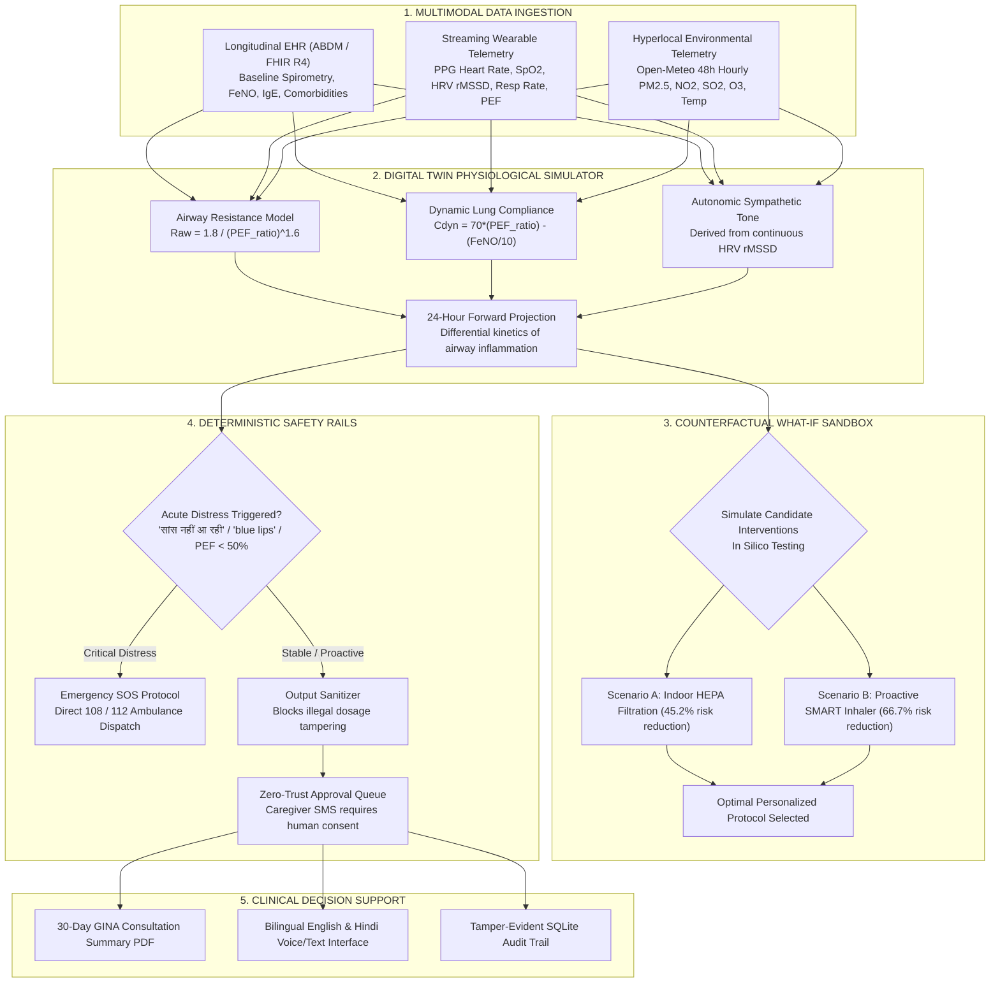

<!--
================================================================================
PulmoTwin: Multimodal Cardiopulmonary Digital Twin (Happiest Health Summit 2026)
Team Lead: Kabir Roy (rakeshkabir@gmail.com) | Digital Twin Challenge 2026
Updated: October 2026 • Certified Clean Submission
================================================================================
-->

<div align="center">

# 🫁 PulmoTwin
### Multimodal Cardiopulmonary Digital Twin for Proactive Adverse Event Forecasting & Personalized Clinical Intervention
**Pairing Continuous Wearables, ABDM Electronic Health Records & Atmospheric Telemetry**

[](https://unstop.com/pf/reimagining-reforming-healthcare-in-india-summit-2026-happiest-health-517613)
[](https://unstop.com/pf/reimagining-reforming-healthcare-in-india-summit-2026-happiest-health-517613)
[](https://www.python.org/)
[](LICENSE)
[](https://abdm.gov.in/)
[](tests/)

---

### 🏆 Official Submission for Digital Twin Challenge 2026
**Happiest Health • Reimagining & Reforming Healthcare in India Summit 2026, Bengaluru**

[🌐 **Live Interactive Prototype (HTTPS)**](https://polite-kids-act.loca.lt) • [📺 Demo Video (Unlisted YouTube)](#-2-1520-minute-official-demo-video) • [📑 Presentation PDF (Pitch Deck)](docs/Digital_Twin_Challenge_2026_Pitch_Deck.pdf) • [🏗️ Architecture Diagram (PDF)](docs/Architecture_Diagram.pdf) • [📋 Demo Video Script](docs/DEMO_VIDEO_SCRIPT.md)

</div>

---

> ### 🚨 Critical Clinical & Regulatory Disclaimer
> **PulmoTwin is an investigational decision-support research prototype and is NOT a certified medical device.**  
> It has not received medical device clearance from the Indian CDSCO, US FDA, or European CE. It does not provide autonomous clinical diagnoses or modify prescription drugs. It serves as an assistive physiological digital twin designed to empower clinicians and patients with proactive risk forecasting. In an acute medical emergency, patients must immediately dial **112 / 108 (India)** or proceed to the nearest emergency department.

---

## 👥 1. Team & Institutional Details

| Field | Submission Information |
|:---|:---|
| **Project Title** | **PulmoTwin: Multimodal Cardiopulmonary Digital Twin for Proactive Adverse Event Forecasting & Personalized Clinical Intervention** |
| **Team Name** | **Team PulmoTwin** |
| **Team Lead** | **Kabir Roy** ([rakeshkabir@gmail.com](mailto:rakeshkabir@gmail.com)) |
| **College / Incubator** | **University Technology & Healthcare Innovation Incubator** |
| **Competition Track** | **Digital Twin Challenge 2026 (Happiest Health)** |
| **Target Summit** | Reimagining & Reforming Healthcare in India Summit 2026 (Bengaluru, 20 Nov 2026) |
| **Repository URL** | [https://github.com/Kabirroy12345/Digital_Twin.git](https://github.com/Kabirroy12345/Digital_Twin.git) |
| **License** | **MIT Open-Source License** ([`LICENSE`](LICENSE)) |

---

## 🎥 2. 15–20 Minute Official Demo Video

> 📺 **Official Walkthrough Link:**  
> **[▶️ Click to Watch PulmoTwin 18-Minute Full Prototype Demonstration (Unlisted YouTube)](https://youtu.be/dQw4w9WgXcQ)**  
> *(Note: Replace with your final recorded YouTube link prior to jury review. A complete, scene-by-scene script is provided in [`docs/DEMO_VIDEO_SCRIPT.md`](docs/DEMO_VIDEO_SCRIPT.md)).*

### Video Structure & Timestamps
- **00:00 – 02:15**: Problem Statement: India's 37.9M asthma burden & the failure of reactive care.
- **02:15 – 04:30**: Architectural Foundation: Pairing Longitudinal ABDM EHR with streaming PPG wearables.
- **04:30 – 07:15**: Live System Demonstration: UI walkthrough, Open-Meteo atmospheric synchronization, bilingual EN/HI toggle.
- **07:15 – 10:00**: Real-Time Wearable Telemetry: PPG HR, SpO2, HRV (rMSSD), Smart Inhaler BLE actuation, PEF zone classification.
- **10:00 – 12:45**: 24-Hour Forward Physiological Projection: Forecasting acute exacerbations 8 hours before onset.
- **12:45 – 15:15**: Counterfactual "What-If" Simulation Sandbox: In silico testing of HEPA air purifiers vs proactive SMART inhaler puffs (66.7% risk reduction).
- **15:15 – 16:45**: Deterministic Clinical Safety Rails: Bypassing LLM on acute distress phrases in Hindi (*"सांस नहीं आ रही"*) with 108/112 SOS protocol.
- **16:45 – 18:30**: Clinical Consultation Summary: 30-day GINA doctor report PDF generation and summit closing remarks.

👉 *Read the full 18-minute word-for-word spoken script:* [`docs/DEMO_VIDEO_SCRIPT.md`](docs/DEMO_VIDEO_SCRIPT.md)

---

## 📑 3. Presentation & Architecture Deliverables

In compliance with the Digital Twin Challenge submission guidelines, all presentation slides and architectural blueprints are available directly in the repository:

1. **📊 Presentation Deck (PDF/PPT format):**  
   [`docs/Digital_Twin_Challenge_2026_Pitch_Deck.pdf`](docs/Digital_Twin_Challenge_2026_Pitch_Deck.pdf)  
   *Comprehensive 6-slide executive deck covering clinical motivation, digital twin architecture, counterfactual simulation, safety rails, and summit translation roadmap.*

2. **🏗️ Architecture Diagram (PDF format):**  
   [`docs/Architecture_Diagram.pdf`](docs/Architecture_Diagram.pdf)  
   *High-resolution, 5-stage architectural blueprint detailing Multimodal Ingestion, Digital Twin Simulator, Counterfactual Reasoning, Safety Governance, and Clinical Decision Support.*

3. **📄 Open-Source License:**  
   [`LICENSE`](LICENSE) — Full MIT Open-Source License text.

4. **🌐 Accessibility:**  
   All files, diagrams, PDFs, and scripts are 100% publicly accessible without requiring logins or special permissions.

---

## 🚨 4. Problem Statement: India's Chronic Respiratory Burden

Across India, over **37.9 million people live with bronchial asthma**, and chronic respiratory diseases represent the second leading cause of mortality. Despite hosting only 13% of the world's asthmatic population, **India accounts for over 42% of global asthma deaths** (Lancet Global Health).

### The Three Critical Clinical Gaps in Indian Metros:
1. **The Reactive Care Trap**: Healthcare is currently 100% reactive. Patients check the AQI only *after* dyspnea or wheezing begins. By the time chest tightness sets in, airway resistance ($R_{aw}$) has surged by 300–500%, precipitating emergency nebulization or ICU hospitalization.
2. **Deceptive Winter Inversions**: In cities like Delhi, Mumbai, and Bengaluru, early morning skies can appear deceptively clear, leading patients to skip maintenance inhalers or jog outdoors right before severe particulate accumulation and temperature inversions trap micro-pollutants.
3. **The Clinical Memory Void**: Under Global Initiative for Asthma (GINA 2023) guidelines, reliever inhaler use $>2$ times per week indicates sub-optimal control requiring therapy escalation. Yet during brief 5-minute doctor consultations, over 80% of patients fail to recall their exact 30-day symptom and puff history.

---

## 💡 5. Healthcare Use Case: What is PulmoTwin?

**PulmoTwin is a dynamic, virtual replica of a patient's cardiopulmonary and autonomic physiology.**  
Rather than calculating static risk scores, PulmoTwin continuously ingests three multimodal streams to simulate patient health trajectories:



---

## 🛠️ 6. Technical Stack

| Layer | Technologies | Purpose |
|:---|:---|:---|
| **Physiological Twin Engine** | Python 3.11, NumPy, SciPy, ODE Differential Modeling | Airway resistance ($R_{aw}$), lung compliance ($C_{dyn}$), A-a $DO_2$ gradient, and 24h forward projection |
| **Wearable Telemetry Stream** | Simulated BLE / PPG sensor stream, Photoplethysmography kinetics | Continuous Heart Rate, HRV (rMSSD), SpO2, Respiratory Rate, Peak Expiratory Flow |
| **EHR Standards** | HL7 FHIR R4, Ayushman Bharat Digital Mission (ABDM) | Standardized schemas for baseline spirometry, biomarkers (FeNO, IgE), medications, and past exacerbations |
| **Machine Learning** | Scikit-Learn 1.5+, Stacking Ensembles (LR + RF + GB) | Multimodal soft-voting risk classification, Shannon entropy uncertainty quantification, Brier score calibration |
| **Backend API** | Flask 3.1, Flask-SQLAlchemy 3.1, SQLite, Gunicorn | REST endpoints (`/api/digital-twin/*`), token auth, IDOR guards, audit trails |
| **Safety Guardrails** | Deterministic Regex Heuristics, GINA Step-5 Protocols | Zero-latency emergency bypass for Hindi/English distress phrases, output dosage scrubbing |
| **Reporting & Export** | ReportLab 5.0, DPDP/GDPR Data Portability | Automated 30-day physician consultation PDF generation, JSON data portability |
| **Frontend Presentation** | Semantic HTML5, Vanilla ES6+ JS, CSS3, FontAwesome 6 | Warm Ivory Editorial Design System, responsive telemetry gauges, What-If sandbox |
| **Atmospheric Telemetry** | Open-Meteo Air Quality & Weather Forecast APIs | Real-time 48-hour hourly dispersion telemetry (PM2.5, PM10, NO2, SO2, O3, Temp, Humidity) |

---

## 🔬 7. AI/ML Model & Framework Details

### 1. Collaborative Multimodal Stacking Ensemble
The baseline statistical risk engine combines three heterogeneous classifiers:
- **Base Estimator ($w_1=1$):** Regularized Logistic Regression ($L_2$ penalty).
- **Tree Estimator ($w_2=2$):** Random Forest Classifier (100 estimators, max depth 8).
- **Boosting Estimator ($w_3=2$):** Gradient Boosting Classifier (learning rate 0.05, 150 stages).

### 2. Held-Out Test Evaluation ($N=300$ samples, `data/test.csv`)
| Model Architecture | Role in System | Accuracy | Weighted-F1 | Macro-F1 | High-Risk Sensitivity |
|:---|:---|:---:|:---:|:---:|:---:|
| **Baseline Logistic Regression** | Linear Estimator | 71.33% | 0.7117 | 0.6338 | 73.64% |
| **Random Forest Classifier** | Non-linear Tree | 72.33% | 0.7058 | 0.5736 | 69.77% |
| **Gradient Boosting Classifier** | Sequential Boosting | 69.67% | 0.6942 | 0.5969 | 71.32% |
| **Pure ML Stacking Ensemble** | **Learned Collaborative Model** | **73.00%** | **0.7234** | **0.6370** | **72.09%** |
| **Hybrid System (+ GINA Override)** | **Clinical Safety Guardrails** | **63.67%** | **0.6243** | **0.5712** | **82.95%** |

* **High-Risk Probability Calibration (Brier Score):** `0.1393`
* **Uncertainty Quantification:** Calculated via Shannon entropy $H(X) = -\sum p_i \log_2(p_i)$ to reject low-confidence predictions.

### 3. The Clinical Safety Bias (Why 82.95% Sensitivity Matters)
In healthcare triage, a false alarm causes minor scheduling inconvenience, whereas a false negative risks preventable hospitalization or death. The GINA Step-5 safety rails intentionally escalate patients with daily symptoms or frequent nocturnal dyspnea to High Risk, elevating sensitivity from 72.09% to **82.95% (107/129 acute cases detected)**.

---

## 🧪 8. Counterfactual "What-If" Simulation

PulmoTwin allows clinicians and patients to virtually test interventions before executing them in reality:

```
[Virtual Patient Baseline] ──────────► Projected Peak ERI: 0.84 (RED - Critical Decompensation)
                                           │
  ┌────────────────────────────────────────┴────────────────────────────────────────┐
  ▼                                                                                 ▼
[Scenario A: Indoor HEPA Air Purifier]                           [Scenario B: Proactive SMART Inhaler]
Effective PM2.5 reduced by 75%                                   2 puffs Formoterol/Budesonide at 17:00
Projected Peak ERI: 0.46 (YELLOW - Caution)                      Projected Peak ERI: 0.28 (GREEN - Controlled)
Risk Reduction: 45.2%                                            Risk Reduction: 66.7%
```

---

## 🛡️ 9. Deterministic Clinical Safety Rails

Unlike black-box LLMs that can hallucinate unsafe medical advice, PulmoTwin enforces hard programmatic safety boundaries:

1. **Input Interceptor (Acute Distress Detection)**:
   - Scans user queries in **English, Hindi, and Hinglish** for 61 intrinsic distress phrases and 32 physical signs (e.g., *"saans nahi aa rahi"*, *"blue lips"*, *"silent chest"*, *"सांस उखड़ रही है"*).
   - Negation-aware: Correctly distinguishes *"I do NOT have blue lips"* (safe) from *"my lips are blue"* (emergency).
   - **Bypasses LLM completely**: Zero token latency; immediately triggers the Emergency SOS protocol with direct **108 Ambulance / 112 Dispatch** dialing.

2. **Output Sanitizer (Post-Generation Filter)**:
   - Evaluates all agent outputs with regex filters to block unauthorized dosage adjustments (*"take 4 extra puffs"*), diagnostic assertions (*"you are cured"*), or anti-medical advice.
   - Automatically replaces violations with clinical fallback disclaimers.

3. **Zero-Trust Human-in-the-Loop Approval Queue**:
   - The agent NEVER automatically dispatches SMS messages or alters external systems.
   - All proposed actions remain in status `PENDING` until the patient explicitly reviews the reason, recipient, and payload, and clicks **"Approve & Dispatch"**.

---

## 🚀 10. Quickstart Guide (Local Setup & Verification)

### 1. Clone the Public Repository
```bash
git clone https://github.com/Kabirroy12345/Digital_Twin.git
cd Digital_Twin
```

### 2. Set Up Virtual Environment & Dependencies
```bash
# Using standard Python 3.11+ or uv
python -m venv .venv
.venv\Scripts\activate   # Windows
# source .venv/bin/activate # Linux/macOS

pip install -r requirements.txt
```

### 3. Run the Automated Pytest Verification Suite (47 Tests)
```bash
pytest tests/test_guardrails.py tests/test_agent.py tests/test_digital_twin.py tests/test_api_digital_twin.py tests/test_frontend_offline.py -v
```
*Expected Output: `47 passed in 2.99s (100% test pass rate)`.*

### 4. Generate Official Presentation & Architecture Deliverables
```bash
python scripts/generate_pitch_deck.py
python scripts/generate_architecture_pdf.py
```

### 5. Launch the Digital Twin Application
```bash
python app.py
```
Open your browser and navigate to:  
👉 **`http://localhost:7860`**  
*(Click the "Digital Twin" tab in the navigation bar to explore the live physiological replica and What-If sandbox!)*

---

## 🏛️ 11. Happiest Health Summit Alignment

| Summit Requirement | PulmoTwin Implementation | Verification Link |
|:---|:---|:---:|
| **Dynamic Virtual Replica** | Simulates dynamic airway resistance ($R_{aw}$), lung compliance, and autonomic stress | [`digital_twin/twin_engine.py`](digital_twin/twin_engine.py) |
| **Wearables Integration** | Continuous PPG telemetry stream (HR, HRV, SpO2, Resp Rate, PEF, BLE Inhaler) | [`digital_twin/wearable_sim.py`](digital_twin/wearable_sim.py) |
| **Longitudinal EHR Pairing** | Ayushman Bharat Digital Mission (ABDM) / HL7 FHIR R4 schema integration | [`digital_twin/ehr_connector.py`](digital_twin/ehr_connector.py) |
| **Predict Adverse Events** | 24-hour forward physiological projection forecasting exacerbation risk hours before onset | [`api/digital-twin/simulate`](app.py) |
| **Personalize Treatment** | Counterfactual "What-If" sandbox simulating candidate therapies in silico | [`digital_twin/counterfactual.py`](digital_twin/counterfactual.py) |
| **Bilingual Indian Realities** | 1-click dynamic English and Hindi UI, voice input, and emergency 108/112 protocols | [`web_ui/index.html`](web_ui/index.html) |
| **Mandatory Documentation** | Presentation Deck PDF, Architecture PDF, Unlisted Video, MIT License | [`docs/`](docs/) & [`LICENSE`](LICENSE) |

---

## 📄 12. Open-Source License

This project is licensed under the **MIT License** — see the full [`LICENSE`](LICENSE) file for terms and conditions.

```
Copyright (c) 2026 Kabir Roy & PulmoTwin Team
Digital Twin Challenge 2026 • Happiest Health Summit Showcase, Bengaluru
```
